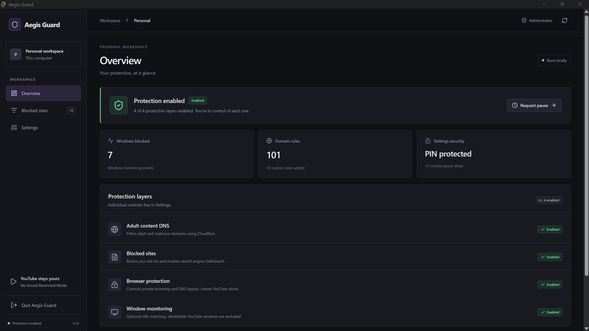
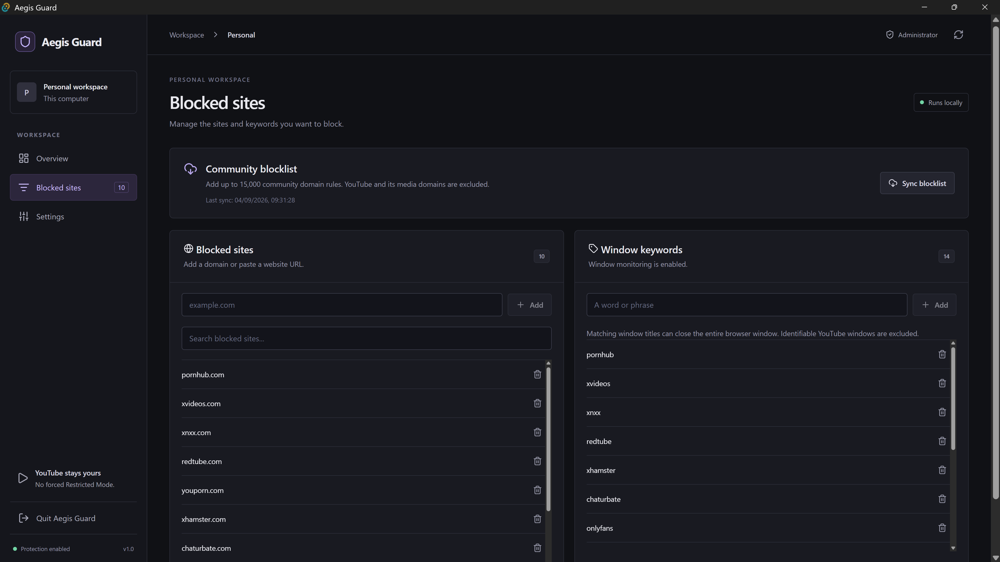
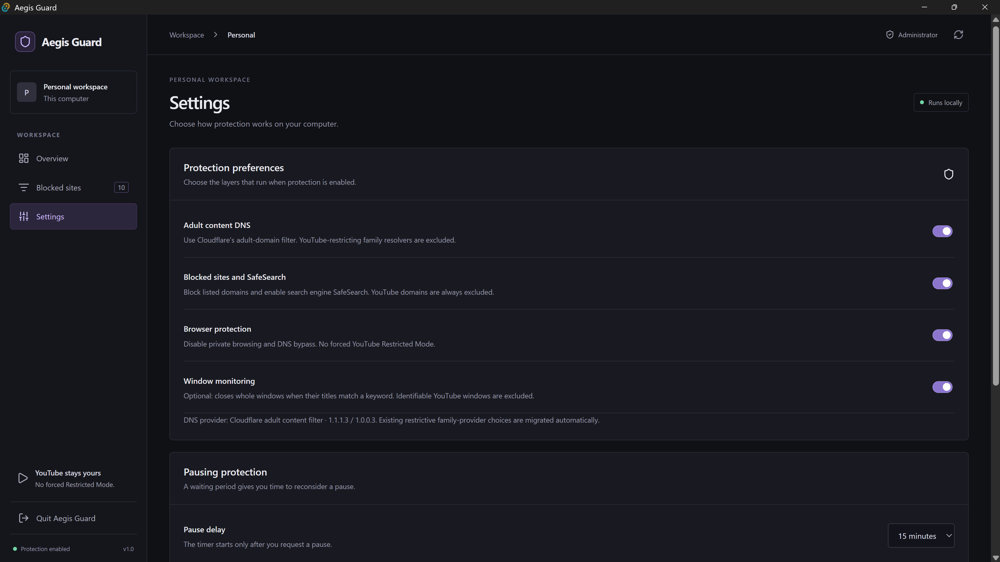
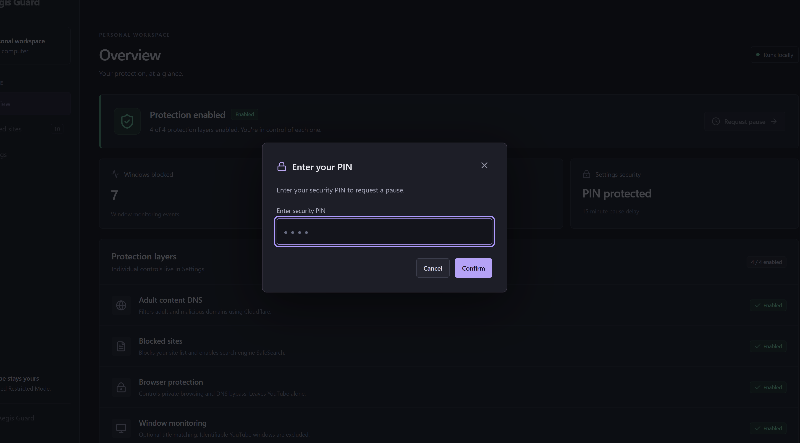

<div align="center">

# Aegis Guard

**Build healthier browsing habits, one boundary at a time.**

An open-source Windows app for blocking unwanted adult content and reducing digital distractions.


[](LICENSE)

[Get started](#getting-started) · [Features](#features) · [Screenshots](#screenshots) · [Contribute](CONTRIBUTING.md) · [Report a bug](https://github.com/NY-Henry/aegis-adult-content-blocker/issues/new/choose)

</div>



## Why Aegis Guard?

Changing compulsive browsing habits can be difficult. Aegis Guard adds practical friction between an impulse and a website, with boundaries you choose, a pause delay, and clear controls. It is a tool to support your own goals and recovery efforts; it does not promise to treat addiction.

The dashboard runs locally in a Windows desktop app. YouTube domains are excluded from site rules, and Aegis does not enforce YouTube Restricted Mode.

## Features

| Feature | What it does |
| --- | --- |
| Adult-content DNS | Uses Cloudflare's adult-content and malware filtering DNS. |
| Site blocking | Applies built-in, custom, and downloaded domain rules through the Windows hosts file, with search-engine SafeSearch redirects. |
| Community blocklist | Syncs up to 15,000 domain rules, excluding YouTube and its media domains. |
| Browser protection | Applies supported browser policies to limit private browsing and DNS bypass. |
| PIN and pause delay | Protects sensitive actions and gives you time to reconsider a pause. |
| Optional window monitoring | Closes foreground windows whose titles match configured keywords. Off by default on new installations. |
| System tray | Open the dashboard, request a pause, or quit the app from the tray. |

## Screenshots

<details>
<summary><strong>Blocked sites and community rules</strong></summary>



</details>

<details>
<summary><strong>Protection settings and pause delay</strong></summary>



</details>

<details>
<summary><strong>PIN-protected actions</strong></summary>



</details>

Screenshots show an example configuration. Available protections and counts depend on your settings.

## Getting started

### Build from source

You need Windows, Node.js 22 LTS, Rust (MSVC toolchain), Microsoft C++ Build Tools, and WebView2. See the [Tauri Windows prerequisites](https://v2.tauri.app/start/prerequisites/#windows).

```powershell
git clone https://github.com/NY-Henry/aegis-adult-content-blocker.git
cd aegis-adult-content-blocker
npm ci
npm run tauri build
```

Windows installers are generated under `src-tauri/target/release/bundle/`. The standalone executable is generated under `src-tauri/target/release/`.

For the repository's portable build helper, first fetch Rust dependencies, then build:

```powershell
cargo fetch --manifest-path src-tauri/Cargo.toml --locked
powershell -NoProfile -ExecutionPolicy Bypass -File scripts/build-portable.ps1
```

The helper builds offline from the fetched dependencies, verifies production mode and embedded dashboard assets, and writes `artifacts/Aegis-Guard-Fixed.exe`. It uses a faster, unoptimized build of the application crate; use `npm run tauri build` for a normal release build. `Launch-AegisGuard.bat` prefers this verified portable executable when present.

### Set up your boundaries

1. Run Aegis Guard as administrator to apply DNS, hosts, and browser protection. The dashboard remains accessible without elevation.
2. Choose protection layers in **Settings**. Configure your PIN and pause delay.
3. Add sites in **Blocked sites**, or sync the community blocklist.
4. Check **Overview** for protection status and any setup errors.

An administrator launch can apply enabled protections immediately. Use a personal machine where you control network and browser settings.

### Pause or quit

**Request pause** in Overview starts your configured delay. Once it finishes, you have five minutes to confirm the pause. PIN checks apply when configured.

Closing the window keeps Aegis in the system tray. Right-click its tray icon for **Open dashboard**, **Pause protection...**, or **Quit app (keep site blocking)**. The dashboard also has a Quit control.

**Quitting stops the app and window monitoring; existing DNS, hosts, and browser settings remain applied.** Pause protection before quitting if you also want those blocking settings removed. If tray creation fails, closing the window exits normally.

### YouTube compatibility

Aegis excludes YouTube, its video-delivery, thumbnail, and embedded-player domains from built-in, custom, and downloaded hosts rules. It does not write Chrome or Edge's enforced YouTube Restricted Mode policy. Older CleanBrowsing Family and AdGuard Family choices migrate to Cloudflare's adult-domain filter.

On an administrator launch, Aegis removes legacy YouTube redirects only inside its own marked hosts section. Older versions did not record browser-policy ownership, so an existing YouTube policy is detected without automatically deleting it. **Restore YouTube** offers an explicit, administrator- and PIN-gated repair. Restart browsers afterward. Network, account, or organization restrictions can still apply independently.

### Know the limits

- Window monitoring matches titles, can close an entire browser window, and cannot reliably identify website origins. Identifiable YouTube windows are excluded. Prefer domain blocking for routine protection.
- DNS and browser protections change Windows settings. DNS reset returns active hardware adapters to automatic DNS; it does not restore a previous custom DNS configuration.
- A local administrator, VPN, or another network configuration may bypass blocking. The app supports voluntary boundaries rather than tamper-proof enforcement.
- Configuration, custom rules, and PIN verification data are stored locally under `%APPDATA%\AegisGuard\config.json`. DNS filtering sends DNS queries to Cloudflare; blocklist sync downloads third-party lists.

## Development

```powershell
npm ci
npm run tauri dev
```

Development launches the real protection engine and can change system settings when elevated. `npm run dev` alone serves the frontend and does not provide the native desktop backend.

| Path | Purpose |
| --- | --- |
| `src/` | React dashboard, settings, and dialogs |
| `src-tauri/src/core/` | Configuration, PIN checks, and shared state |
| `src-tauri/src/engine/` | DNS, hosts, browser policies, and window monitoring |
| `src-tauri/src/commands.rs` | Native commands exposed to the dashboard |
| `scripts/` | Portable build helper |
| `tests/` | Isolated browser fixture and smoke tests |

### Verification

```powershell
npm run build
cargo test --manifest-path src-tauri/Cargo.toml --lib --features custom-protocol --locked -- --include-ignored
```

Build the frontend first: the native packaging regression test checks that its dashboard assets are embedded. Native tests cover domain validation, YouTube exclusions, hosts migration, configuration compatibility, and cooldown behavior without applying Windows protection.

For isolated interface checks:

```powershell
npm install --no-save --package-lock=false playwright
npx playwright install chromium
node tests/ui-smoke.mjs
```

The test-only native fixture does not change Windows settings. It covers navigation, settings, PIN retry and cancellation, pause requests, YouTube repair, and responsive layout. Screenshots and generated test builds go into the ignored `artifacts/` directory. To reuse a temporary Playwright installation, pass its `index.mjs` path as the first argument; set `AEGIS_BROWSER_PATH` to reuse a Chromium executable.

Direct Cargo release builds require `--features custom-protocol`. A release guard rejects development-mode packaging. The executable's `--verify-bundle` option verifies embedded assets without starting protection, which helps catch builds that incorrectly try to connect to a localhost development server.

## Contributing and support

Bug reports, accessibility improvements, documentation, and carefully scoped fixes are welcome. Read [CONTRIBUTING.md](CONTRIBUTING.md) before opening a pull request. Please keep conversations respectful and avoid sharing personal browsing histories, PINs, or configuration files in public issues.

For vulnerabilities, follow [SECURITY.md](SECURITY.md).

## Acknowledgments

Built with Tauri, Rust, React, TypeScript, and Lucide icons. Community blocklist synchronization uses the [StevenBlack hosts project](https://github.com/StevenBlack/hosts); its sources and licensing are maintained upstream. DNS filtering is provided by Cloudflare.

## License

[MIT](LICENSE) - free to use, modify, and share.
